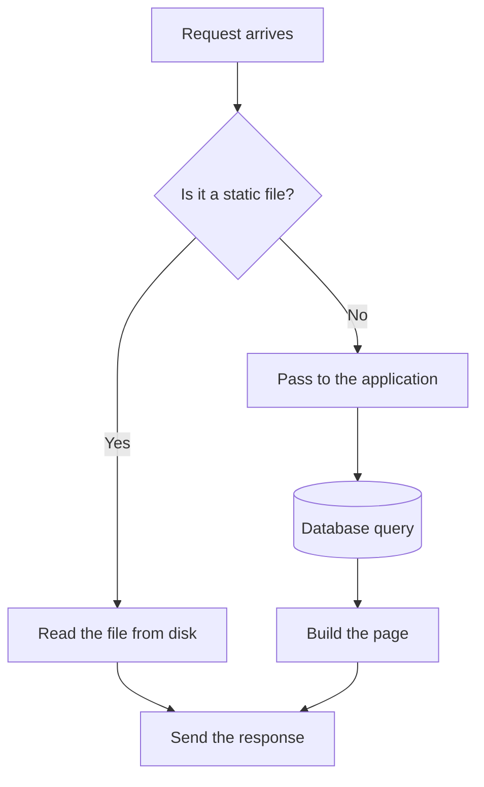
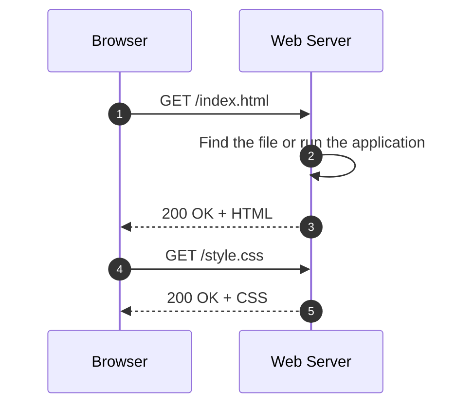
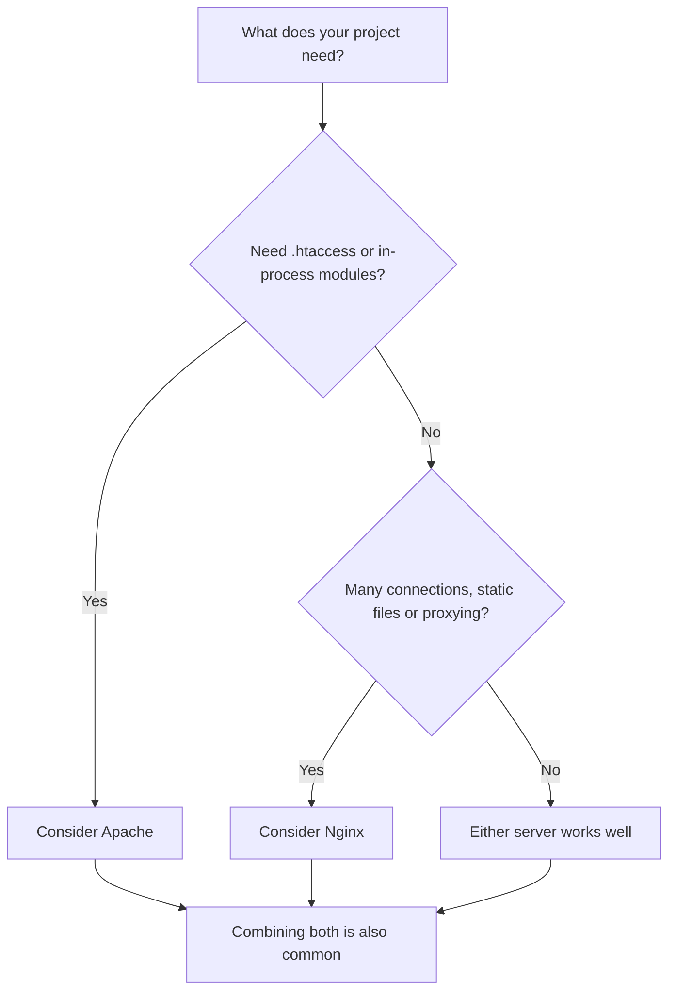
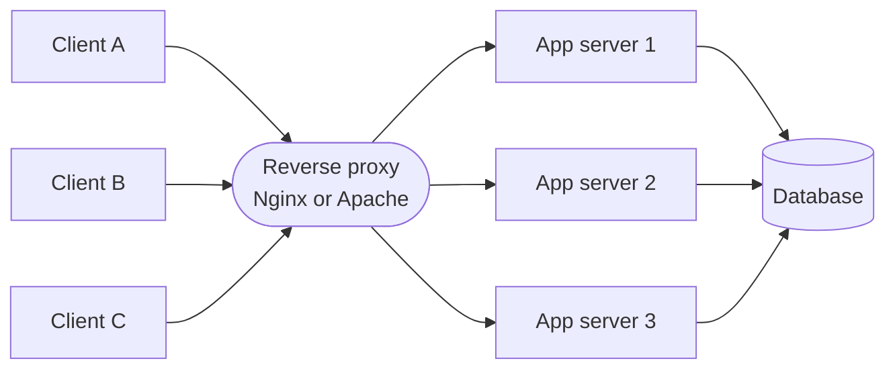

---
---

<p align="center">
  
</p>

<h1 align="center">Web Servers Explained</h1>
<h3 align="center"><em>Understanding Apache and Nginx</em></h3>

<p align="center">
  <strong>Author:</strong> Sujan &nbsp;|&nbsp; BCA Technical Blog Assignment &nbsp;|&nbsp; November 2026
</p>

<p align="center">
  <a href="#table-of-contents">Contents</a> &nbsp;•&nbsp;
  <a href="#7-apache-vs-nginx-comparison">Comparison</a> &nbsp;•&nbsp;
  <a href="#9-conclusion">Conclusion</a>
</p>

---

## Table of Contents

1. [Introduction](#1-introduction)
2. [What is a Web Server?](#2-what-is-a-web-server)
3. [How Does a Web Server Work?](#3-how-does-a-web-server-work)
4. [HTTP and HTTPS](#4-http-and-https)
5. [Apache HTTP Server](#5-apache-http-server)
6. [Nginx](#6-nginx)
7. [Apache vs Nginx Comparison](#7-apache-vs-nginx-comparison)
8. [Real-World Applications](#8-real-world-applications)
9. [Conclusion](#9-conclusion)

---

## <a id="1-introduction"></a>1. Introduction

<table class="split" border="0" cellspacing="0" cellpadding="12">
<tr>
<td class="fig" width="40%" valign="top" align="center">


<br>
<sub><b>Figure 1.</b> Apache (1995) and Nginx (2004) are two generations of open-source web servers.</sub>

</td>
<td class="txt" width="60%" valign="top">

Every time you open a website, a web server is working behind the scenes. It receives your browser's request, finds or generates the right content, and sends it back, usually in a fraction of a second.

Two open-source programs dominate this role: **Apache HTTP Server**, first released in 1995, and **Nginx** (pronounced "engine-x"), first released publicly in 2004. They solve the same basic problem with different designs.

This article explains what web servers do, how HTTP and HTTPS carry data, how Apache and Nginx are built, and how to choose between them. No prior server experience is needed.

</td>
</tr>
</table>

> **💡 Key idea:** a web server is a *translator between URLs and content*. You type an address; it decides which file or program should answer.

[↑ Back to contents](#table-of-contents)

---

## <a id="2-what-is-a-web-server"></a>2. What is a Web Server?

<table class="split" border="0" cellspacing="0" cellpadding="12">
<tr>
<td class="fig" width="40%" valign="top" align="center">


<br>
<sub><b>Figure 2.</b> A web server sits between clients and the resources that produce content.</sub>

</td>
<td class="txt" width="60%" valign="top">

The term has two meanings. As **hardware**, it is a computer that stores website files and stays connected to the internet. As **software**, it is a program that accepts HTTP requests and returns responses. This article focuses on the software meaning.

A web server typically does four jobs:

- **Serves static content** such as HTML, CSS, JavaScript and images directly from disk.
- **Passes dynamic requests** to an application (PHP, Python or Node.js), which may query a database.
- **Secures traffic** by using TLS certificates for HTTPS.
- **Records activity** in access and error logs for monitoring and debugging.

Both Apache and Nginx run on Linux, the most common hosting platform.

</td>
</tr>
</table>

[↑ Back to contents](#table-of-contents)

---

## <a id="3-how-does-a-web-server-work"></a>3. How Does a Web Server Work?

<table class="split" border="0" cellspacing="0" cellpadding="12">
<tr>
<td class="fig" width="40%" valign="top" align="center">


<br>
<sub><b>Figure 3.</b> Loading a page is a short conversation in five steps.</sub>

</td>
<td class="txt" width="60%" valign="top">

Loading a page is a short conversation between client and server:

1. **DNS lookup:** the browser converts `www.example.com` into an IP address.
2. **TCP connection:** the browser connects to the server, normally on port 80 (HTTP) or 443 (HTTPS).
3. **TLS handshake:** for HTTPS, both sides agree on encryption keys.
4. **HTTP request:** the browser asks for a resource such as `/index.html`.
5. **HTTP response:** the server replies with a status code and the content.

The browser then reads the HTML and usually sends further requests for stylesheets, scripts and images. Modern HTTP versions can reuse one connection for many of these requests.

</td>
</tr>
</table>

Inside the server, each request follows a simple decision path: serve a file directly, or hand the work to an application.



<details>
<summary><strong>📘 Key terms for beginners (click to expand)</strong></summary>

| Term | Meaning |
|---|---|
| **IP address** | The numeric address of a computer on a network. |
| **DNS** | The system that translates domain names into IP addresses. |
| **Port** | A numbered "door" on a server; 80 is the HTTP default and 443 is the HTTPS default. |
| **TLS certificate** | A digital document that proves the server's identity and enables encryption. |
| **Upstream** | A backend server that a proxy forwards requests to. |
| **Reverse proxy** | A server that receives client requests on behalf of one or more backend servers. |

</details>

[↑ Back to contents](#table-of-contents)

---

## <a id="4-http-and-https"></a>4. HTTP and HTTPS

<table class="split" border="0" cellspacing="0" cellpadding="12">
<tr>
<td class="fig" width="40%" valign="top" align="center">


<br>
<sub><b>Figure 4.</b> An HTTP request (top) and the matching response (bottom).</sub>

</td>
<td class="txt" width="60%" valign="top">

**HTTP** (Hypertext Transfer Protocol) defines how clients and servers exchange messages. A request contains a method (such as `GET` or `POST`), a path and headers. A response contains a status code, headers and, usually, a body.

Common status codes include `200 OK`, `301 Moved Permanently`, `404 Not Found` and `500 Internal Server Error`.

Plain HTTP is not encrypted, so others on the network path could read or alter the data. **HTTPS** is HTTP carried over **TLS** (Transport Layer Security), which provides:

- **Encryption:** eavesdroppers cannot read the traffic.
- **Integrity:** data cannot be modified unnoticed.
- **Authentication:** a certificate lets the browser verify the server's identity.

Apache and Nginx both support TLS and HTTP/2.

</td>
</tr>
</table>

The sequence below shows the same exchange over time, including the follow-up request a browser makes for a stylesheet.



<details>
<summary><strong>📘 HTTP methods and status-code classes (click to expand)</strong></summary>

| Method | Typical purpose |
|---|---|
| `GET` | Retrieve a resource |
| `HEAD` | Retrieve only the headers of a resource |
| `POST` | Send data to the server, such as a form |
| `PUT` | Replace a resource with the data sent |
| `DELETE` | Remove a resource |

| Status class | Meaning | Example |
|---|---|---|
| `1xx` | Informational | `101 Switching Protocols` |
| `2xx` | Success | `200 OK` |
| `3xx` | Redirection | `301 Moved Permanently` |
| `4xx` | Client error | `404 Not Found` |
| `5xx` | Server error | `500 Internal Server Error` |

</details>

[↑ Back to contents](#table-of-contents)

---

## <a id="5-apache-http-server"></a>5. Apache HTTP Server

<table class="split" border="0" cellspacing="0" cellpadding="12">
<tr>
<td class="fig" width="40%" valign="top" align="center">


<br>
<sub><b>Figure 5.</b> Apache chooses how to handle connections through a Multi-Processing Module (MPM).</sub>

</td>
<td class="txt" width="60%" valign="top">

The **Apache HTTP Server** (`httpd`) is developed by the Apache Software Foundation and released under the Apache License 2.0. It is known for flexibility and a large module ecosystem.

**Processing models.** Apache uses *Multi-Processing Modules (MPMs)* to decide how connections are handled. Only one MPM is active at a time:

- **prefork:** several single-threaded processes, each serving one connection at a time. It suits code that is not thread-safe.
- **worker:** several processes, each running multiple threads, so one process can serve many connections.
- **event:** based on worker, but a listener thread manages idle keep-alive connections so worker threads are not tied up waiting.

Which MPM runs depends on the operating system, how Apache was built and how it is configured. It is therefore wrong to say that every Apache server uses one process per request.

**Other features.** Apache loads modules such as `mod_ssl`, `mod_rewrite` and `mod_proxy`. It also supports per-directory `.htaccess` files, which let users change settings without editing the main configuration. This is convenient on shared hosting, but the official documentation advises avoiding them when you can edit the main configuration.

</td>
</tr>
</table>

A minimal Apache virtual host that serves one site looks like this:

```apache
<VirtualHost *:80>
    ServerName www.example.com
    DocumentRoot /var/www/example
</VirtualHost>
```

[↑ Back to contents](#table-of-contents)

---

## <a id="6-nginx"></a>6. Nginx

<table class="split" border="0" cellspacing="0" cellpadding="12">
<tr>
<td class="fig" width="40%" valign="top" align="center">


<br>
<sub><b>Figure 6.</b> Nginx workers each run an event loop that serves many connections.</sub>

</td>
<td class="txt" width="60%" valign="top">

**Nginx** was created by Igor Sysoev with a focus on handling many simultaneous connections efficiently. Today it is also widely used as a reverse proxy, load balancer and HTTP cache. It is released under a BSD-style licence.

**Event-driven architecture.** Nginx runs a *master process* that reads the configuration and manages several *worker processes*. Each worker runs an event loop built on operating-system mechanisms such as `epoll` on Linux and `kqueue` on BSD systems. Because I/O is non-blocking, a worker does not wait on a slow connection: it switches to another connection that is ready.

This avoids dedicating a process or thread to every connection, which helps memory use when many connections are open. The number of workers is usually matched to the number of CPU cores, for example with `worker_processes auto;`.

**Dynamic content.** Nginx does not embed a PHP interpreter. It forwards such requests to an external service such as PHP-FPM through FastCGI. Configuration lives in central files; there is no equivalent of `.htaccess`.

</td>
</tr>
</table>

The equivalent Nginx `server` block is similarly short:

```nginx
server {
    listen 80;
    server_name www.example.com;
    root /var/www/example;
    index index.html;
}
```

[↑ Back to contents](#table-of-contents)

---

## <a id="7-apache-vs-nginx-comparison"></a>7. Apache vs Nginx Comparison

<table class="split" border="0" cellspacing="0" cellpadding="12">
<tr>
<td class="fig" width="40%" valign="top" align="center">


<br>
<sub><b>Figure 7.</b> A side-by-side summary of the main design differences.</sub>

</td>
<td class="txt" width="60%" valign="top">

| Aspect | Apache | Nginx |
|---|---|---|
| **Design** | Process/thread MPMs (prefork, worker, event) | Event-driven master and workers |
| **Configuration** | Main files plus optional `.htaccess` | Central files only |
| **Dynamic content** | `mod_php` (in-process) or PHP-FPM | External backend via FastCGI or proxy |
| **Modules** | Loadable at runtime | Built in, or dynamic modules (since 1.9.11) |
| **Strengths** | Flexibility, rich modules, per-directory control | Many connections, static files, proxying |
| **Trade-offs** | `.htaccess` adds overhead; prefork uses more memory per connection | No per-directory overrides; changes need a reload |

Neither server is universally faster. Results depend on hardware, configuration and workload, so test your own application before deciding.

</td>
</tr>
</table>

> **💡 Note:** The two are not rivals in every setup. Many deployments place Nginx in front of Apache and use each for what it does best.

A simple decision path for choosing a starting point:



[↑ Back to contents](#table-of-contents)

---

## <a id="8-real-world-applications"></a>8. Real-World Applications

<table class="split" border="0" cellspacing="0" cellpadding="12">
<tr>
<td class="fig" width="40%" valign="top" align="center">


<br>
<sub><b>Figure 8.</b> A reverse proxy gives clients one address and spreads requests across backends.</sub>

</td>
<td class="txt" width="60%" valign="top">

- **Learning and development:** XAMPP, popular for PHP and MySQL practicals, bundles Apache HTTP Server.
- **Shared hosting:** `.htaccess` support lets many customers manage their own sites on one server.
- **Static sites and media delivery:** Nginx serves files efficiently and can cache responses.
- **Reverse proxy:** a server in front of your applications handles HTTPS, caching and access control.
- **Load balancing:** requests are spread across several backends, and a failed backend can be skipped. Nginx offers methods such as round robin, least connections and IP hash; Apache provides this through `mod_proxy_balancer`.
- **Combined stacks:** Nginx handles TLS and static files while Apache runs applications that rely on `.htaccess`.

</td>
</tr>
</table>

The flowchart shows a typical deployment with a reverse proxy in front of several application servers sharing one database.



In Nginx, a basic load-balanced reverse proxy uses an `upstream` group. With no extra option, requests are distributed in round-robin order:

```nginx
upstream app_backend {
    server 10.0.0.11:8080;
    server 10.0.0.12:8080;
}

server {
    listen 80;

    location / {
        proxy_pass http://app_backend;
    }
}
```

[↑ Back to contents](#table-of-contents)

---

## <a id="9-conclusion"></a>9. Conclusion

<table class="split" border="0" cellspacing="0" cellpadding="12">
<tr>
<td class="fig" width="40%" valign="top" align="center">


<br>
<sub><b>Figure 9.</b> Starting points for choosing between the two servers.</sub>

</td>
<td class="txt" width="60%" valign="top">

Apache and Nginx are both mature, widely deployed and actively maintained. Apache offers flexibility through MPMs, modules and `.htaccess`. Nginx offers an event-driven design that suits many concurrent connections, static content and proxying. The better choice depends on requirements, team experience and workload, and the two can work together.

**Key takeaways**

- A web server receives HTTP(S) requests and returns responses.
- Apache can use process-based or threaded MPMs; the active one depends on configuration.
- Nginx uses a master process and worker processes with event loops.
- Test with your own workload instead of relying on general claims.

</td>
</tr>
</table>

[↑ Back to contents](#table-of-contents)

---

<p align="center">
  <sub>Written by Sujan · BCA Technical Blog Assignment · Diagrams are original SVG files stored in <code>images/</code></sub>
</p>
